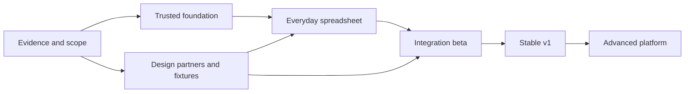

# OpenSheet roadmap

Updated **2026-10-22**. Baseline: development preview **0.1.1**, commit `fb76c4e`. Proposed milestones below are not release commitments or descriptions of shipped features.

[Competitive research](docs/competitive-research.md) explains the evidence. [TODO](TODO.md) owns executable work and completion state. [Implementation status](docs/implementation-status.md) remains authoritative for shipped behavior.

## 1. Destination

Make OpenSheet a leading open-source embedded spreadsheet: dependable enough to trust with important data, pleasant enough for daily work, simple enough to integrate, and maintainable enough to outlast its initial authors.

The initial product is a permissively licensed, local-first spreadsheet SDK for business worksheets, local file editing and verifiable automation. It should earn adoption on correctness, interoperability transparency, interaction quality and extensibility. “Industry-leading” is an acceptance program, not a release label.

### Product principles

1. An acknowledged edit survives the documented failure model; a failed operation never publishes half a workbook.
2. Unsupported input is identified and reported. A file extension is not a compatibility guarantee.
3. UI, plugins and agents use the same validated commands, formula semantics and revision model.
4. Essential local workflows work without an OpenSheet account or hosted service. Optional transports must preserve that property.
5. The default distribution stays permissively licensed; dependency additions receive explicit license and size review.
6. Measured evidence and independent users determine quality. Stars, demos and generated feature counts do not substitute for it.

## 2. What “top-tier” means in measurable terms

These are **proposed acceptance targets**, not current achievements. Any target change requires an ADR that preserves previous results and explains the user impact.

| Dimension           | v1 acceptance                                                                                                                                         | Longer-term excellence                                                          |
| ------------------- | ----------------------------------------------------------------------------------------------------------------------------------------------------- | ------------------------------------------------------------------------------- |
| Data integrity      | No unresolved critical/high data-loss defects in supported workflows; fault injection covers commit, cancellation, recovery, quota and upgrade        | Public reproducible failure corpus and independently reproduced recovery        |
| Formula correctness | Every claimed function/construct has independent expected results, boundary cases and sync/async agreement; no unexplained mismatch in release corpus | Broader business/financial/array semantics driven by real workbooks             |
| Editing             | Complete documented core task suite by mouse and keyboard; native CJK IME verified                                                                    | Low error rate and competitive task completion in user studies                  |
| Accessibility       | Core tasks complete with NVDA + Chrome on Windows and VoiceOver + Safari on macOS; blockers fixed                                                     | Broader assistive technology coverage and external audit                        |
| Performance         | 1m mixed populated cells pass existing three-round 100 ms edit / 33 ms scroll / 10 s restore protocol on declared reference configurations            | 10m stretch target and competitive published traces across workloads            |
| Interoperability    | 100% of assertions in the published supported-feature fixture set pass; every known unsupported fixture is reported or blocked                        | Public corpus expanded from consented real integration needs                    |
| Integration         | Vanilla/React/Vue production examples pass install, edit, reopen, replacement and disposal; SSR guidance verified                                     | Independent plugins and more host environments without private API dependencies |
| Stability           | Public API/schema/command versions, migration policy, deprecation policy and consumer tests enforced                                                  | Predictable support window and compatible ecosystem                             |
| OSS health          | At least two active release-capable maintainers and three independent pilot integrations; security/release process rehearsed                          | Sustainable contributor pipeline, public governance and funding                 |

Reference performance configurations must include a declared macOS/Chromium machine and a Windows/Chromium mainstream laptop; record physical hardware and power mode before setting baselines. WebKit and Firefox receive correctness coverage and separate performance observations; do not imply identical throughput. If available hardware cannot meet the target, fix the implementation or publish a smaller supported profile through an explicit scope decision. Do not silently relax the thresholds.

## 3. Current position

Already present: asynchronous Worker/IndexedDB engine, atomic staging and recovery, persistent undo/redo, Canvas editor, formula subset, native formats, SheetJS adapter, compatibility reports, plugins, framework wrappers and reproducible benchmark scripts.

Current priority gaps: capacity acceptance across reference platforms, limited formula coverage, incomplete independent file validation, real accessibility/IME acceptance, framework-host E2E, upgrades and release operations. As of 2026-10-23, the runtime registry contains **45 built-in formula functions**; their documented semantics and independent-reader differences remain part of acceptance. This is not an Excel-scale formula catalog. Current multi-tab coordination allows a single writer; it is not multi-user collaboration.

Do not rebuild existing primitives just to make a roadmap item appear complete. Extend their contracts and evidence. Historical test counts and October 7 measurements do not certify a later release.

## 4. Milestone sequence

| Milestone                 | Indicative release | Outcome                                                        | Entry dependency               | Exit evidence                                                                         |
| ------------------------- | ------------------ | -------------------------------------------------------------- | ------------------------------ | ------------------------------------------------------------------------------------- |
| M0 — Evidence and focus   | 0.2 candidate      | Reproducible baseline, product scope and current documentation | None                           | Baseline report, workload/fixture catalog, prioritized integration findings           |
| M1 — Trusted foundation   | 0.3 candidate      | Durable, recoverable, responsive and accessible core           | M0 scope/baseline              | Recovery matrix, strict 1m results, IME/reader acceptance, current browser checks     |
| M2 — Everyday spreadsheet | 0.4–0.6 candidates | Core business worksheets complete end to end                   | M1 model/command stability     | Formula corpus, validation/formatting/clipboard workflows and independent file checks |
| M3 — Integration beta     | 0.7–0.9 candidates | Stable contracts and real host adoption                        | M2 supported feature profile   | Framework matrix, plugin conformance, migrations, pilot reports                       |
| M4 — Stable v1            | 1.0 RC → 1.0       | A small, dependable, supportable public platform               | All prior required gates       | Full release evidence bundle, RC soak, no critical/high blockers                      |
| M5 — Advanced platform    | 1.x / future major | Collaboration, advanced analysis and broader scale             | Separate demand + design gates | Each capability has an RFC, owner, budget and its own acceptance suite                |

Version ranges describe intended packaging, not a promised exact sequence. Feature-complete and stable are distinct decisions.

## 5. M0 — Evidence and focus

**Why first:** optimization without reproducible traces and feature expansion without users can consume months without improving adoption.

- Reproduce `pnpm check`, browser suites, package-consumer checks and production Pages path against the selected baseline. Keep this research's historical observations separate from new results.
- Establish dataset families: dense scalar, sparse distant cells, repeated/unique long text, formula fan-out/chains, formatting/merges and file exchange.
- Build a trace that separates queueing, storage, decoding, calculation, cache misses and painting. Preserve cold/warm and success/failure records.
- Interview five developers and run three integration attempts. Publish anonymized blockers and approved synthetic fixtures; do not collect private workbooks by default.
- Correct stale docs and create a capability matrix with implemented/partial/unverified/planned states.

**Gate:** baseline is reproducible; first two M1 tasks have owners and measurable hypotheses; supported initial jobs and exclusions are documented. If no users are available, retain scope as provisional and continue foundation work, but do not claim product validation.

**Backlog:** DOC-01, DISC-01–02, PERF-01, IO-01.

## 6. M1 — Trusted foundation

**Why:** data integrity, responsiveness and basic input are prerequisites for every later feature.

- Exercise crash/termination, aborted transactions, quota, stale tabs, cleanup failure and lock handover with actual Workers/IndexedDB. A saved indicator means durable acknowledgement, not optimistic UI state.
- Define native-file and persisted-engine migration behavior before another storage rewrite. Preserve the previous usable data if migration fails or is interrupted.
- Optimize measured cold-page and dispersed-edit bottlenecks. Keep cache reservations distinct from total main/Worker/process memory. Avoid making compression ratio the sole objective.
- Complete keyboard task coverage, native Chinese/Japanese/Korean IME trials and manual screen-reader tasks. Include errors, merges, frozen panes and multi-sheet navigation.
- Add Firefox correctness coverage, capability detection and actionable errors for unavailable browser facilities.

**Gate:** strict 1m target passes on declared reference configurations; integrity matrix passes; no unresolved critical/high accessibility/input blocker in core tasks. Failure of the performance gate keeps the milestone open even when storage round trips succeed.

**Backlog:** COR-01–03, PERF-02–03, UX-01–02, QA-01–02.

## 7. M2 — Everyday spreadsheet

### Calculation

Use a semantic corpus before expanding counts. Cover numbers/text/booleans/blanks, coercion, error propagation, lazy branches, precision, date systems and reference transforms. Select the exact function profile using discovery, with a default proposed first wave:

- Conditional aggregation: SUMIF, SUMIFS, COUNTIF, COUNTIFS, AVERAGEIF, AVERAGEIFS.
- Lookup: exact VLOOKUP, INDEX, MATCH, XLOOKUP with explicitly documented argument/match-mode coverage.
- Text: LEFT, RIGHT, MID, LEN, TRIM, CONCAT, TEXTJOIN, UPPER, LOWER.
- Dates: DATE, YEAR, MONTH, DAY, DAYS; define 1900/1904 behavior before volatile TODAY/NOW.
- Rounding/logic: ROUNDUP, ROUNDDOWN, INT, MOD, IFNA, IFS.

The list is an initial profile, not a promise that a similarly named function has every Excel mode. Function documentation must list unsupported modes. Named ranges, formula-result sorting and incremental recalculation need structural/undo tests. Dynamic arrays, financial functions and external references have separate later gates.

### Data and editing

Implement basic validation (numbers, dates, lists, custom rules), typed editors, conditional rules, multi-column filters and stable sorting. Complete fill series, paste-special, find/replace and reference-aware formula editing. Every operation must participate in commands, history and native persistence.

### Interoperability

Establish a supported XLSX profile and independent reader matrix. Verify dates, types, formulas, number formats, styles, merges, row/column metadata and sheet identity. Add mappings only when the selected adapter can preserve them; otherwise report or block. Detect losses before users overwrite their original file. Keep native JSON/binary as the supported-state interchange, not a reason to ignore XLSX defects.

**Gate:** three representative workflows (order worksheet, budget model, local file review) pass from import/input to export/reopen. Formula fixtures and supported file assertions pass with no unexplained mismatches. Known losses appear in reports and UI. Validation and formatting survive undo/reopen.

**Backlog:** CALC-01–07, UX-03–05, DATA-01–04, IO-02–05.

## 8. M3 — Integration beta

- Freeze a candidate public API and review promise/cancellation/error semantics, resource limits and revision preconditions.
- Verify packaged installs in Vanilla/Vite, React Strict Mode, Vue mount/unmount and a client-only SSR route. Document CSP, worker asset paths and storage requirements.
- Ship public examples with realistic saving/error/retry UI; measure time to first working workbook with external developers.
- Create plugin conformance checks for dependencies, version ranges, cleanup, resource limits and public-only API usage. Trusted plugins remain trusted code.
- Add agent task examples with bounded reads, change preview, expected revision, atomic application and verification. Keep model-provider/network code outside core.
- Release migration guides, fixture compatibility tests, deprecation rules and consistent generated API documentation.

**Gate:** at least three independent integrations complete the supported workflows without copying internals; public package and schema compatibility checks pass; no unresolved critical/high lifecycle or migration defect. Preview-only features are clearly excluded from stable contracts.

**Backlog:** DX-01–04, EXT-01–02, AGENT-01–02, REL-01, DOC-02, OSS-01–03.

## 9. M4 — Stable v1

Release only when all required M0–M3 tasks and the following operational tasks are complete:

- Re-run correctness, browser, integrity, performance, compatibility and package acceptance on the exact RC commit.
- Publish known limitations, browser/runtime support, formula profile, file support matrix and upgrade/downgrade behavior.
- Rehearse build/package/release provenance, integrity checks, a failed release and a fix-forward procedure.
- Have two maintainers able to release and triage security reports; publish contribution/review rules and a realistic support policy.
- Run a proposed four-week RC observation period with pilot integrations. Restart the affected acceptance checks after material fixes; elapsed time alone is not a pass.
- Publish the benchmark harness and results before any comparative performance statement. A benchmark comparison is desirable; a numerical “best” ranking is not a v1 requirement.

**Gate:** release checklist signed off by maintainers; no known unresolved critical/high defect in declared supported workflows; every claim links to evidence for the RC. Ordinary defects can ship with documented impact/workaround only if they do not violate a required gate.

**Backlog:** PERF-04, OSS-04–05, REL-02–03 and all prior required items.

## 10. M5 — Advanced platform, with entry tests

| Initiative                      | Why it could matter                          | Must be true before implementation                                            | Acceptance outline                                                                                    |
| ------------------------------- | -------------------------------------------- | ----------------------------------------------------------------------------- | ----------------------------------------------------------------------------------------------------- |
| Collaborative editing           | Shared team workflows                        | At least two pilot users require it; transport/identity/conflict RFC approved | Offline reconnect, duplicate messages, revocation, concurrent structural edits and shared undo tested |
| Native charts                   | Self-contained reporting sheets              | Chart model and serialization decided; demand beyond demo charts              | Source range changes, undo, persistence and export limitations verified                               |
| Pivot tables                    | Interactive analysis                         | Table/range semantics and aggregate engine stable                             | Refresh, filters, totals, type/error handling and memory bounds verified                              |
| Dynamic arrays                  | Modern spreadsheet models                    | Spill ownership and dependency semantics designed                             | Spill collisions, structural edits, invalidation and undo verified                                    |
| Financial/statistical functions | Specialized business adoption                | Domain fixture sets and maintainers exist                                     | Independent numerical references and documented tolerance                                             |
| Print/PDF                       | Report delivery                              | Pagination/print-area model and renderer chosen                               | Repeated headers, scaling, page breaks and independent viewer review                                  |
| 10m interactive capacity        | Larger local workloads                       | 1m gate stable; demand and memory budget documented                           | Same strict protocol, no substituted hot-cell test                                                    |
| Remote/Node runtime             | Server automation or alternative persistence | Storage abstraction ADR and actual host need                                  | Same command/fixture contracts, cancellation and crash behavior                                       |
| Legacy migration                | Lower switching cost                         | Real Luckysheet/Jspreadsheet fixtures and demand                              | Explicit mapping/loss report and source backup                                                        |
| Mobile/RTL expansion            | Broader input and locale coverage            | Desktop core stable; target user and device matrix selected                   | Touch/virtual keyboard/RTL task suite and performance profile                                         |

No CRDT/OT library is selected in advance. Stable cell identities alone do not solve concurrent sorting, structural edits, formulas or collaborative undo. Multi-tab read-only coordination must never be presented as collaboration.

Out of committed v1 scope: VBA execution, complete Excel/Google Sheets parity, enterprise identity/billing, marketplace hosting, arbitrary untrusted plugin execution, full office suite and live external-data credentials inside the core.

## 11. Capacity, scheduling and tradeoffs

Actual team capacity is unknown. Planning assumption for discussion: two full-time engineers with regular part-time design/QA and maintainer review, allocating roughly 60% to planned features, 25% to correctness/integration and 15% to docs/community. This is a scenario, not staffed capacity.

| Stage | Indicative elapsed range under that assumption | Main uncertainty                                                     |
| ----- | ---------------------------------------------- | -------------------------------------------------------------------- |
| M0    | 2–3 weeks                                      | Access to independent integrations and reference devices             |
| M1    | 6–10 weeks                                     | Storage/performance root causes and manual accessibility remediation |
| M2    | 10–16 weeks                                    | Formula semantics and file fidelity                                  |
| M3    | 6–10 weeks                                     | Pilot feedback and API/migration changes                             |
| M4    | 4–6 weeks                                      | RC defects and release operations                                    |

Sequential scenario: roughly **28–45 weeks**, including the RC period, before contingency. These broad ranges are not summed TODO estimates; discovery must decompose larger work and re-estimate. One maintainer should reduce scope, not promise the same calendar. More engineers do not remove semantic dependencies or external validation needs.

If time is constrained, defer charts, pivots, collaboration, broad financial formulas and legacy adapters first. Do not trade away acknowledged-data integrity, truthful compatibility, keyboard/IME correctness or migration safety. Review scope every two weeks and the roadmap monthly; refresh competitor sources before public comparisons.

## 12. First execution cycle

1. DOC-01 and DISC-01: align current claims and pin acceptance workloads.
2. PERF-01 and COR-01: reproduce traces and attack failure paths before optimization.
3. IO-01 and CALC-01: establish independent correctness fixtures.
4. UX-01 and UX-02: expose native input/accessibility blockers early.
5. DISC-02: feed real integration failures back into the proposed formula and workflow scope.

Execution can overlap only where dependencies allow. Every active item needs a named owner, reviewer, expected artifact and definition of done. The detailed backlog is the source of truth for completion.
